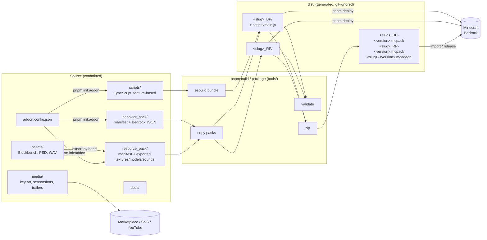
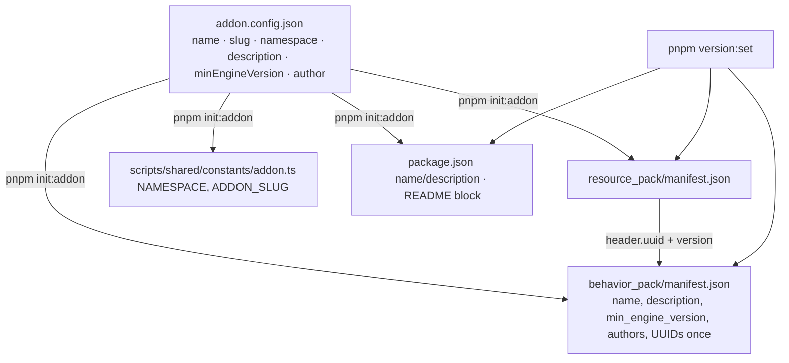
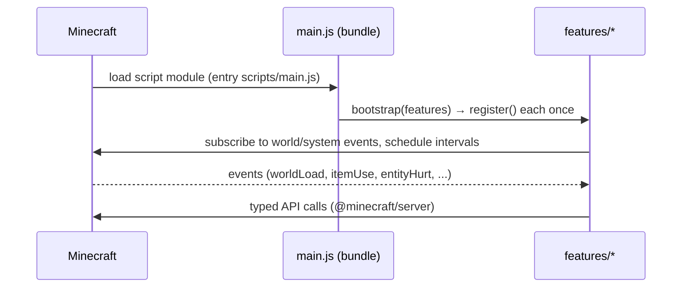
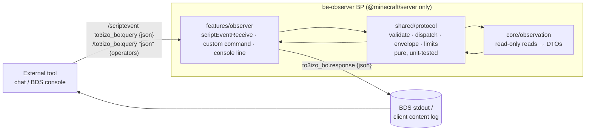

# ARCHITECTURE

How the pieces of this repository relate, and what flows where.

## Overview

## Components

### Behavior Pack (`behavior_pack/`)
Server-side definitions in Minecraft's own folder layout: blocks, items, entities, recipes, loot,
spawn rules, functions, structures, and the `manifest.json` that declares the `data` module, the
`script` module (`entry: scripts/main.js`) and the dependency on the resource pack. It never contains
scripts in the source tree.

### Resource Pack (`resource_pack/`)
Client-side, game-ready files: textures and the atlases that name them (`item_texture.json`,
`terrain_texture.json`), geometry, client entities, animations and controllers, render controllers,
particles, sounds, and `.lang` strings. Everything here is an *export*; sources stay in `assets/`.

### Script (`scripts/`)
TypeScript compiled by esbuild into a single ES module. Organised by feature
(`features/<feature>/`), with engine plumbing in `core/` and pure helpers in `shared/`.
`@minecraft/*` modules stay external and are provided by the game. See `scripts/AGENTS.md`.

### Assets (`assets/`)
Editable originals that produce resource pack content (Blockbench projects, layered images, audio
projects, references). Not read by Minecraft, not copied anywhere automatically.

### Media (`media/`)
Marketing and distribution material (Marketplace key art and screenshots, SNS and YouTube images,
trailers, press kit). Separated into `source/` (editable) and per-destination export folders.
Never enters a pack. See `media/AGENTS.md`.

### Build (`tools/`)
Plain Node.js + TypeScript scripts, run directly by Node (type stripping, no transpile step):

| Script | Role |
| --- | --- |
| `tools/init-addon.ts` | Writes Add-On identity into config, manifests, constants, package.json, README; generates UUIDs once |
| `tools/validate.ts` + `tools/checks/*` | Type-check, strict JSON, manifest rules, identifier/namespace rules, resource reference integrity |
| `tools/build.ts` | clean → copy packs → bundle scripts → validate `dist/` |
| `tools/package.ts` | strict validate → build → `.mcpack` ×2 + `.mcaddon` (zip via fflate) |
| `tools/deploy.ts` | Copy `dist/` packs into Minecraft's `development_*_packs` |
| `tools/dev.ts` | Watch and rebuild (optionally deploy) |
| `tools/set-version.ts` | Keep package.json, manifests and dependency versions in sync |
| `tools/clean.ts` | Remove `dist/` |

### Distribution (`dist/`, GitHub Releases)
`dist/<slug>_BP/` and `dist/<slug>_RP/` are what Minecraft loads during development.
`dist/<slug>-<version>.mcaddon` (both packs) and the two `.mcpack` files are what players import.
`release.yml` builds them on a `v*` tag and attaches them to the GitHub Release.

## Identity and configuration flow

- UUIDs are generated only while a manifest still holds the template placeholder; afterwards they are
  immutable (see root `AGENTS.md` → UUID policy).
- `pnpm validate` cross-checks the config against both manifests so drift is caught in CI.

### Decisions (`docs/adr/`)
Why the Add-On is built the way it is (rejected alternatives, accepted limitations, dated history) is kept in
the ADRs, one decision per file; the other documents state the current design only.

## Runtime view

## Observer architecture

Bedrock Observer splits the script into three layers so the observation core knows nothing about how requests
arrive or where answers go (`docs/adr/0003-read-only-scriptevent-protocol.md`):

- `shared/protocol` imports nothing from `@minecraft/*` (unit-testable with `node --test`). It holds the generic
  dispatcher; `core/observation/methods.ts` supplies the handler table, typed to match `shared/protocol/methods.ts`.
- `core/observation` calls only read APIs; `tests/validation/read-only.test.ts` guards that.
- `features/observer` is the only place that knows about `/scriptevent`, the operator command (ADR-0010) and the
  log prefixes. Both entry points hand the same JSON text to the same dispatcher.
- There is no network adapter (`@minecraft/server-net` was rejected, ADR-0004). Moving log lines from the BDS host
  to another machine is done outside Minecraft by the external tool (`docs/PROTOCOL.md` §9).
